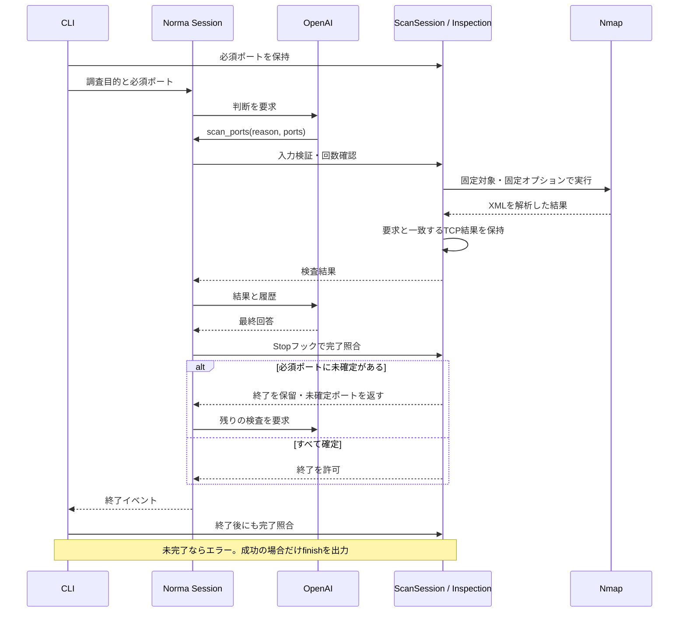

# ポート検査エージェントの実装フロー

記録日: 2026-11-12

## 目的

ホストへnmapや追加のGo依存をインストールせず、Docker内で検査を実行する。
AIには検査の提案と結果の説明を任せ、実行可能な操作と成功終了の条件はGoで管理する。
現時点の対象は、自分のPCの `127.0.0.1` に限定している。

## 実装の経緯

| 段階 | 実装・変更 | 判断の理由 |
|---|---|---|
| 1. Goリポジトリの初期化 | `go.mod`、最小CLI、README、Git除外設定を作成 | モジュール名は公開先未定のため `pentest` とした |
| 2. nmapのDocker化 | Debian上でnmapを導入するDockerfileを作成 | ホストへのaptインストールを避けるため |
| 3. Goからnmapを実行 | 最初の標準ライブラリによるTCP接続実装を、`exec.CommandContext` によるnmap呼び出しへ置き換えた | 求められていたのはnmapを利用する検査だったため |
| 4. XMLからJSONへの変換 | nmapの `-oX -` を読み、状態・プロトコル・サービス名をJSON出力 | GoやAIから扱える構造にするため |
| 5. ホストの検査 | Linuxの `--network host` に対応する実行手順を整備 | 通常のDocker実行では `127.0.0.1` はコンテナ自身を指すため |
| 6. スクラッチ版のAIループ | OpenAI Responses APIのStructured Outputsで `reason / action / ports` を受信し、結果を次の判断へ渡す | AIによる提案→実行→再判断を明示的に実装するため |
| 7. Norma SDK版 | Sessionとツール呼び出しへ移行し、比較用にスクラッチ版を残した | 会話履歴やツール結果の引き渡しをSDKへ任せるため |
| 8. DDDに沿った責務分離 | domain / application / infrastructure / interfacesとCLI起動部に分離 | 業務ルールをnmapやAIの接続方式から独立させるため |
| 9. `.env` の導入 | APIキーとモデルをDocker実行時に渡す手順を追加 | ソースやイメージへ認証情報を含めないため |
| 10. 完了条件の厳密化 | 必須ポートを明示し、要求と結果をメモリに保持してGoで照合 | モデルが終了しただけでは、依頼された検査の完了を保証できないため |

## 現在の責務と依存関係

| 場所 | 責務 |
|---|---|
| [`cmd/pentest/main.go`](../cmd/pentest/main.go) | 環境変数の読み取り、全体の制限時間、終了コード |
| [`internal/interfaces/cli/run.go`](../internal/interfaces/cli/run.go) | 引数検証、依存の組み立て、JSON出力 |
| [`internal/domain/portscan/scan.go`](../internal/domain/portscan/scan.go) | アクション・ポート・結果のモデルと入力制約 |
| [`internal/domain/portscan/inspection.go`](../internal/domain/portscan/inspection.go) | 必須ポートと結果の保持、未確定ポートの判定 |
| [`internal/application/scan.go`](../internal/application/scan.go) | Scanner契約、スキャンの試行回数管理、完了照合、スクラッチ版の実行手順 |
| [`internal/infrastructure/nmap/scanner.go`](../internal/infrastructure/nmap/scanner.go) | nmap起動、XML解析、ドメインモデルへの変換 |
| [`internal/infrastructure/openai/client.go`](../internal/infrastructure/openai/client.go) | スクラッチ版のOpenAI通信とJSON応答の解析 |
| [`internal/infrastructure/norma/workflow.go`](../internal/infrastructure/norma/workflow.go) | NormaのSession・ツール・終了フックとの接続 |

ドメインは外部SDK・HTTP・コマンド実行・nmap XMLに依存しない。
アプリケーションは自分で定義したScannerインターフェースを通じて検査を要求する。
CLI側で具体的なアダプターを組み立て、外部アダプターは内側のルールに従う。
JSONタグは出力形式の互換性のためモデルに残している。

保存先を切り替える要件はまだないため、RepositoryやDB、永続化層は導入していない。

## 実行と設定

`.env` の `OPENAI_API_KEY` に利用者のAPIキーを設定し、`OPENAI_MODEL` に対応モデルを指定する。
`.env` はGitとDockerビルドの対象外であり、リポジトリのクローンだけでは作成されない。
APIキーの値をログやドキュメントへ貼り付けない。

```sh
docker build -t pentest-nmap .

docker run --rm --network host --env-file .env \
  pentest-nmap --agent 'HTTP用の別ポートを確認して' --ports 8080,8443
```

`--agent` を `--scratch` に替えると、同じScannerと検査ルールを使うスクラッチ版になる。
両モードとも `--ports` は必須で、自然文から必須ポートを推測しない。

AIを使わず、固定のTCPポート22・80・443・8080だけを調べる場合:

```sh
docker run --rm --network host pentest-nmap 127.0.0.1
```

`--network host` はこの手順ではLinuxホストを検査するために利用している。
省略した場合、検査対象はコンテナ自身のループバックになる。

## Norma版の実行フロー



「次に何を調べるか」はモデルが判断する。一方、成功の `finish` を認めるかはGoが判断する。
モデルの最終回答はSDKの終了イベントを経由し、Go側で `action: finish` のJSONに変換する。
出力の `step` はスキャン試行の番号であり、モデルへの問い合わせ回数ではない。

SDKのStopフックには、ツール実行を挟まない終了拒否を無限に繰り返さない仕組みがある。
モデルが追加検査をせず再び終了した場合に備え、SDK終了後も完了を照合している。
この場合は無条件に再ループせず、未完了エラーで停止する。

## スクラッチ版の実行フロー

1. 必須ポート・未確定ポート・検査履歴を `DecisionInput` にする。
2. OpenAIへ送り、Structured OutputsによるアクションJSONを解析・検証する。
3. `scan_ports` なら共通のScanSessionで実行し、結果を保持する。
4. `finish` でも未確定ポートがあれば拒否し、理由を `feedback` に入れて次の判断へ進む。
5. 全必須ポートが確定した `finish` だけを出力する。判断上限に達したらエラー終了する。

Norma版では履歴とツール結果の対応をSDKに任せ、スクラッチ版では自分で管理している。
共通化するのは検査のルールと結果保持であり、両方式のループ制御そのものは比較できる形で残している。

## 完了の条件と状態保持

- 必須ポートは正しい番号であることを検証し、コピー・整列・重複除去して保持する。
- 成功したスキャン結果のうち、その呼び出しで要求した必須TCPポートの結果だけを保持する。
- `open` と `closed` は確定として扱う。`filtered`、未知の状態、結果欠落、UDPは完了条件を満たさない。
- スキャナーが失敗した場合、その呼び出しの結果は記録しない。失敗した試行も回数上限には数える。
- 状態は1プロセスのメモリ内だけに置く。終了すると失われ、再開・履歴参照はできない。

確定とは、その実行時にnmapから得た結果が揃ったことを指す。
外部ネットワークからの到達性や、稼働サービスの種類、AIの文章の正確さまでは保証しない。

## 実行範囲と制限

対象は `127.0.0.1`、nmap引数は `-sT -Pn -n -p <検証済みポート> -oX -` に固定する。
AIに対象・シェルコマンド・追加のnmapオプションを渡させない。

1回は最大100ポート、番号は1〜65535。スキャン試行は合計10回まで。
Normaは最大10ツールターン、スクラッチ版は完了要求も含めて最大10回の判断とする。
nmapは1回30秒、CLI全体は5分。API通信の再試行は無効だが、Normaの回復処理は別途働く。
Normaに登録するツールは `scan_ports` だけで、既定のシェル・ファイル・バックグラウンドツールは無効にする。

調査目的と検査結果はOpenAIへ送信され、API利用料金が発生する。
APIエラー本文には入力などが含まれる可能性があるため、標準エラーへそのまま出力しない。

## 検証した範囲

Dockerビルド時に `go test ./...` と `go build ./cmd/pentest` を実行する。

| 確認方法 | 確認内容 |
|---|---|
| ドメインのテスト | 必須ポートのコピー・整列・重複除去、対象外や未確定の結果を完了扱いにしないこと |
| アプリケーションのテスト | 結果保持、失敗を含む試行上限、早すぎるfinishの拒否、残りの検査、未完了終了 |
| nmapアダプターのテスト | 固定引数、XML変換、不正XML・実行失敗・不正ポートの扱い |
| 模擬OpenAIとNormaのテスト | 結果の再送、Stopフックでの再検査、欠落・filtered・失敗時にfinishを出さないこと |
| CLIのテスト | 必須の `--ports`、設定不足、入力不正、JSON出力 |
| 最終イメージの起動確認 | 実nmapによるコンテナ自身の固定スキャンと、設定不足時の通信前停止 |

利用者からは、必須ポート照合を追加する前のNorma版について、実OpenAIとホスト検査の出力が共有されている。
必須ポート照合を含む最終版は、模擬APIとテスト用スキャナーによる検証までであり、
実OpenAIを使ったホスト検査の通し実行は未確認。

## 参照

- [起動方法と現在の仕様](../README.md)
- [固定したNorma SDKのソース](https://github.com/Autumn-27/Norma/tree/4f5684e567607ade605320100ec118056ab38155)
- [OpenAI Structured Outputs](https://developers.openai.com/api/docs/guides/structured-outputs)
